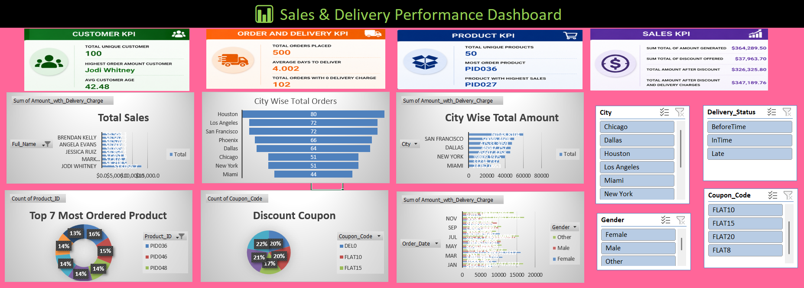

# E-commerce Sales & Delivery Dashboard (Excel)

An Excel analysis of 500 online orders from 100 customers across 50 products. It has a cleaned working dataset, 7 pivot tables, a KPI sheet and an interactive dashboard with 12 charts and 2 slicers.

## Questions this project answers
- How much did the store sell, and how much did discounts and delivery charges change the total?
- Which cities, months and customer groups bring in the most sales?
- Which products sell the most, and which earn the most?
- How are coupon codes used, and how fast are orders delivered?

## Data
- 500 orders with customer details, order and product IDs, price, quantity, coupon code, delivery charge and delivery dates.
- Synthetic dataset provided as part of the Imarticus module.
- Customer name, email and address columns are not included in this repository.

## What I did
1. Kept the `raw_data` sheet untouched and did all cleaning in a separate `working_data` sheet.
2. Added calculated columns, such as the order amount with the delivery charge.
3. Built 7 pivot tables (`pivot_table` sheet) for city, month, gender, product, coupon and customer views.
4. Calculated the headline numbers in the `KPI's` sheet.
5. Built the `DashBoard` sheet with 12 charts and 2 slicers so the views can be filtered.

## Key numbers
| KPI | Value |
|---|---|
| Orders placed | 500 |
| Unique customers / products | 100 / 50 |
| Total sales before discount | 364,289.49 |
| Total discount given | 37,963.73 |
| Total after discount | 326,325.76 |
| Total after discount and delivery charges | 347,189.76 |
| Average days to deliver | 4.0 |
| Orders with zero delivery charge | 102 |
| Average customer age | 42.5 |

## What the pivots show
- **Houston** is the top city on both counts: 80 orders and about 60,100 in sales. **Miami** is lowest, with 44 orders and about 24,800.
- Monthly sales peak in **April** (about 38,600) and are lowest in **May** (about 22,800).
- **PID036** is the most ordered product (17 orders), while **PID027** earns the most (about 18,900).
- The five coupon codes are used fairly evenly: FLAT8 (111 orders), FLAT20 (104), FLAT10 (100), FLAT15 (83) and DEL0, the free-delivery code (102).

## Tools and skills
Excel: pivot tables, slicers, charts, formulas, data cleaning, KPI design.

## Files
- `M2S7_Excel_Mini_Project_data.xlsx`: the full workbook (raw data, working data, pivots, KPIs, dashboard)
- `images/dashboard.png`: screenshot of the dashboard

## My role
I decided what to analyse and how to structure the workbook. AI assistance was allowed for this module project.

## Author
Meer Adeen Ali · Hyderabad · [LinkedIn](https://www.linkedin.com/in/adeen-ali) · [GitHub](https://github.com/Adeen0504)

Built during the Imarticus Postgraduate Program in Data Science and Analytics with GenAI.
